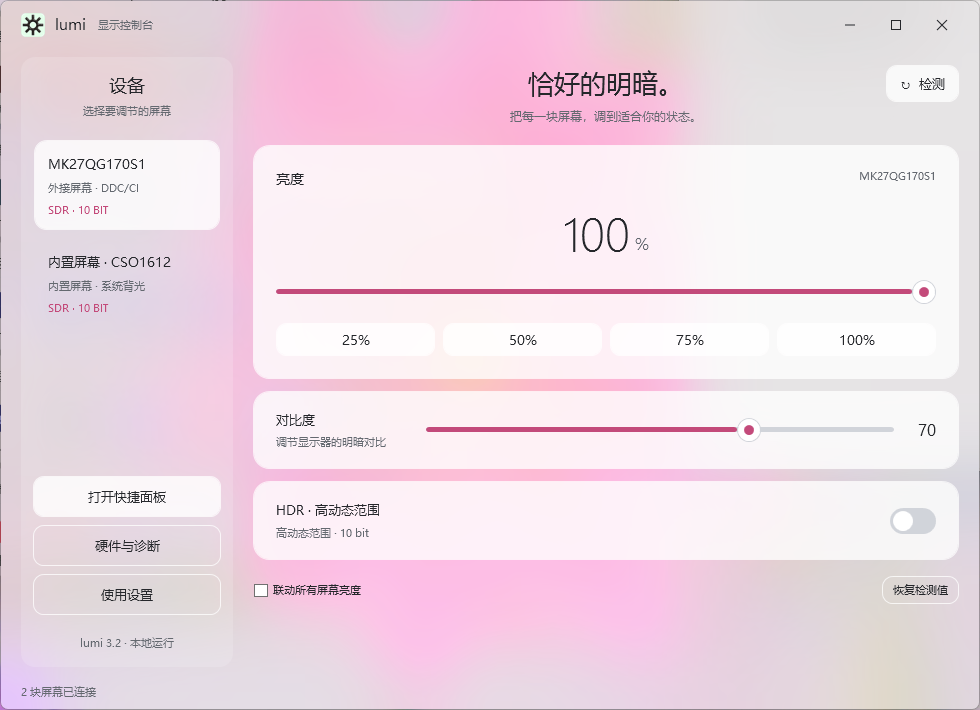
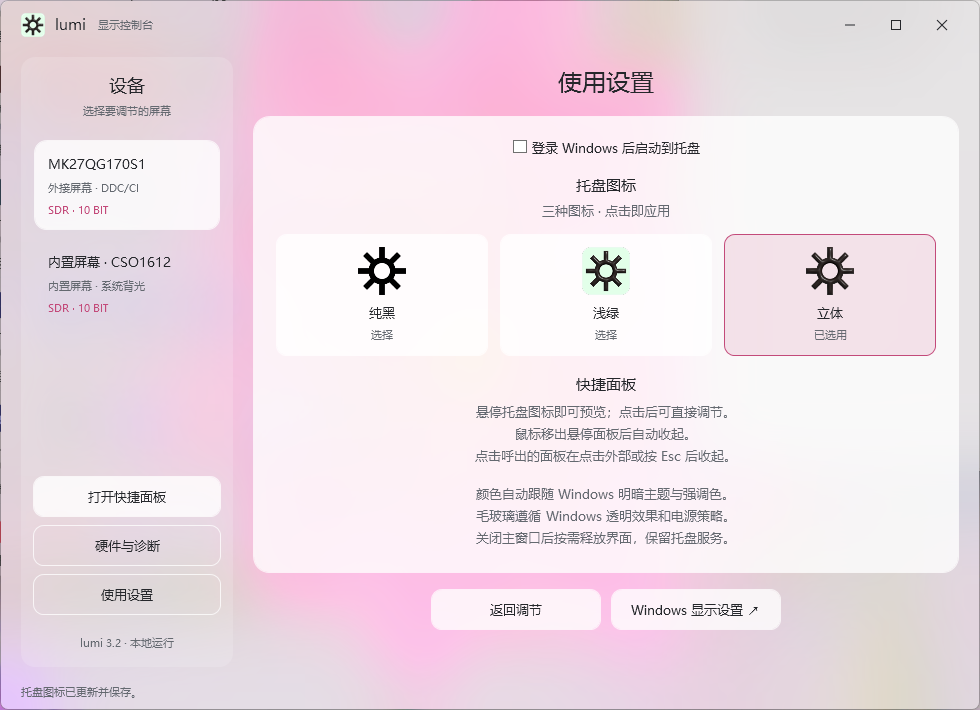
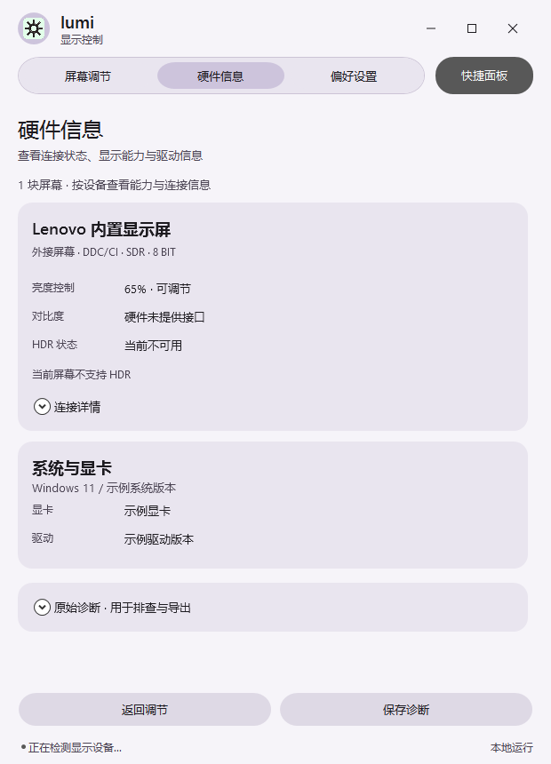
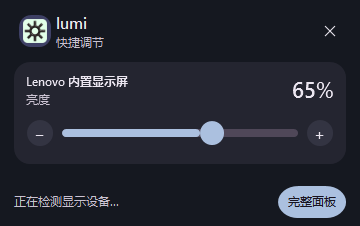

# lumi

Windows x64 本地屏幕调节工具。当前版本：**界面与硬件信息更新 · 2026-10-19**。

[下载最新便携包](https://github.com/02AHvdK/lumi/raw/refs/heads/main/lumi.zip) · [使用指南](lumi%20使用指南.md) · [更新说明](docs/更新说明-2026-10-19.md)

解压后运行 `lumi.exe`。更新前请通过托盘右键菜单退出旧版本。推荐 Windows 11 x64、.NET Framework 4.8；EXE 未签名。DDC/CI、HDR 与原生圆角支持取决于设备和 Windows 环境。

## 本次更新

- 修复快捷面板未显示应用 Logo 的问题。

- 硬件信息按设备分组，连接详情与原始诊断支持折叠。
- 调整文字大小、间距和界面层次。
- 修正主窗口与快捷面板的重复圆角和边框。
- 优化快捷面板弹出位置，移除滑条操作时的矩形描边。
- 增加主题和强调色选择，并保存设置。

## 功能

- 多屏亮度、加减微调、预设与可选联动；按设备能力提供对比度和 HDR。
- 托盘悬停或点击呼出快捷面板；按图标位置、工作区与 DPI 定位。
- 跟随系统／浅色／深色主题，系统或自选强调色。
- 三款托盘图标、登录启动与诊断导出。
- 硬件信息按设备分组，连接详情与原始诊断折叠显示。

## 界面预览

当前版本 WPF 渲染截图使用模拟设备数据，不包含桌面合成器的原生裁切与阴影。

### 屏幕调节

### 外观设置

### 硬件信息

### 快捷面板

## 构建与验证

在 Windows PowerShell 执行 `./src/build.ps1`，生成 `src/lumi.exe`。使用系统 .NET Framework 编译器，不依赖浏览器运行时。

[56 项自动检查通过](docs/validation/layout-tests.txt)，包含布局、按钮处理、主题保存、硬件分组、托盘定位计算和 DWM 圆角参数。使用模拟屏幕，零硬件写入。实际鼠标全流程、混合 DPI 桌面和原生圆角视觉效果尚未人工验证。

回归入口：`./src/lumi.exe --layout-test C:/Temp/lumi-layout-check`。测试会临时保存并恢复主题设置，请勿与另一个 lumi 实例同时运行。`--test` 与 `--ui-test` 会操作真实设备，不属于上述零写入检查。

`demo.gif` 为旧版历史演示，不代表当前 UI。
